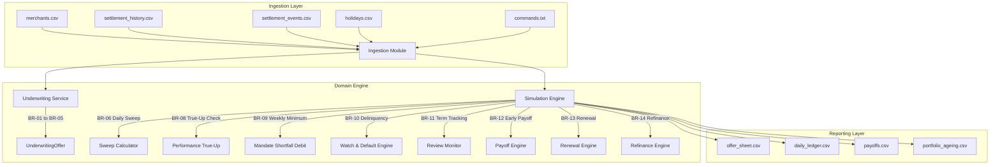
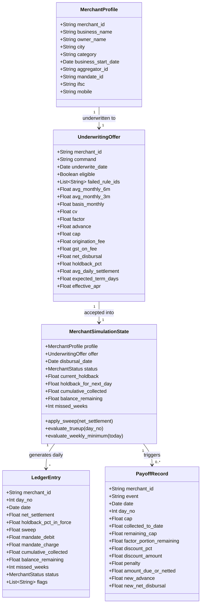
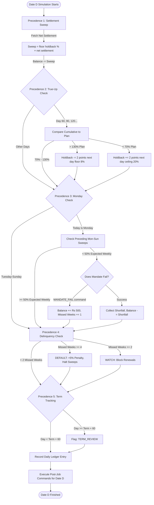

# PS-027 · Merchant Cash Advance & Revenue-Based Financing Engine
## Technical Design Document (Week 1–3 Deliverable)

**Team ID:** T096  
**Problem Statement:** PS-027  
**Domain:** BFSI — Alternative Lending & Revenue-Based Financing (RBF)  
**Target Platform:** Python 3.10+ (Clean OOP Architecture, Command-Driven)

---

## 1. Executive Summary & Domain Glossary

### 1.1 Business Overview
Traditional commercial lending relies on fixed monthly installments (EMIs) with compounding interest, penalizing small businesses during seasonal revenue slumps. 
**Revenue-Based Financing (RBF)** and **Merchant Cash Advances (MCA)** solve this by purchasing a specified amount of future payment receivables at a discounted purchase price. Instead of charging interest:
1. The lender advances upfront capital to the merchant (`Advance`).
2. The merchant agrees to repay a fixed total sum (`Repayment Cap = Advance × Factor Rate`).
3. The lender automatically sweeps a fixed percentage (`Holdback %`) of daily card and UPI settlement payouts.
4. If daily revenue is high, repayment accelerates; if revenue drops, repayment naturally slows down.
5. Periodic **True-Ups** adjust the holdback percentage mid-term to maintain target tenure, while bank mandates protect against severe underperformance.

---

### 1.2 Domain Glossary

| Financial Term | Technical Definition & Domain Context |
| :--- | :--- |
| **Gross Sales** | Total customer payments processed via Point-of-Sale (POS) terminals or UPI gateways before aggregator deductions. |
| **MDR (Merchant Discount Rate)**| Fee charged by payment aggregators (typically 1.5% of gross sales) for processing card/UPI transactions. |
| **Refunds** | Reversals processed on customer returns. Deducted from daily gross sales. |
| **Net Settlement** | `Gross Sales − MDR − Refunds`. This is the net cash payout credited to the merchant, against which holdback sweeps are calculated. |
| **Advance Amount** | Upfront principal capital disbursed to the merchant based on underwriting basis metrics. |
| **Factor Rate** | Fixed pricing multiplier (e.g., `1.12`, `1.18`, `1.25`) representing total financing markup. There is **no compounding interest**. |
| **Repayment Cap** | Total obligation repayable: `Advance × Factor Rate`. |
| **Holdback Percentage** | Daily sweep percentage (default 12%, range 8%–20%) withheld from net daily aggregator payouts. |
| **Expected Term** | Target repayment duration in days: `Cap / (Holdback × Average Daily Settlement)`. Target range is 120 to 270 days. |
| **True-Up** | Periodic performance adjustment (on Day 60 and every 30 days thereafter) comparing cumulative collections to planned collections, stepping holdback up or down. |
| **Bank Mandate** | Pre-authorized NACH/e-Mandate on merchant's bank account used to debit weekly shortfalls on Mondays when sweep collections drop below 50% of expectation. |
| **WATCH Status** | Delinquency warning state triggered after 2 missed weekly shortfall debits. Blocks new advances or renewals. |
| **DEFAULT Status** | Critical failure state triggered after 4 missed weekly shortfall debits. Accelerates total remaining balance plus 5% penalty, and ceases daily sweeps. |
| **Early Payoff** | Settlement prior to full term. Yields a 50% factor markup discount before Day 90, or 25% discount on or after Day 90. |
| **Refinance** | Taking over merchant financing from an external lender. Caps advance at 1.0× basis settlements and nets off external payoff amount. |

---

## 2. System Architecture & Component Design

The engine is structured according to **Clean Architecture** principles, maintaining strict separation between domain logic, persistence ingestion, command dispatching, and reporting.



---

## 3. Entity Domain Class Diagram



---

## 4. Merchant Account State Machine

```mermaid
stateDiagram-v2
    [*] --> PROSPECT : Merchant Profile Ingested
    PROSPECT --> ELIGIBLE : Underwriting passes BR-01 & BR-03
    PROSPECT --> INELIGIBLE : Fails BR-01 or BR-03
    INELIGIBLE --> [*]

    ELIGIBLE --> ACTIVE : ACCEPT Command / Net Disbursal (Day 0)
    
    ACTIVE --> ACTIVE : Daily Sweep / Successful Mandate Debit
    ACTIVE --> WATCH : 2 Missed Weekly Shortfall Debits (BR-10)
    WATCH --> ACTIVE : (Cured / Monitored)
    WATCH --> DEFAULT : 4 Missed Weekly Shortfall Debits (BR-10)
    
    DEFAULT --> DEFAULT : Accelerated Balance + 5% Penalty (Sweeps Halted)
    
    ACTIVE --> CLOSED : Balance = Rs 0 (Cap fully collected)
    ACTIVE --> CLOSED : EARLY_PAYOFF Command (BR-12 Discount)
    ACTIVE --> RENEWED : RENEW Command (>= 60% Collected, Net-Off)
    
    CLOSED --> [*]
    DEFAULT --> [*]
    RENEWED --> ACTIVE : New Advance Activated
```

---

## 5. Daily Job Precedence Flowchart (BR-07)

Every calendar date $D$ executes with strict priority ordering:



---

## 6. Business Rule Register (`BR-01` to `BR-14`)

| Rule ID | Name | Mathematical Formula / Condition | Output / State Impact | Code Routine |
| :--- | :--- | :--- | :--- | :--- |
| **BR-01** | Merchant Eligibility | $\text{History Days} \ge 180$, $\mu_{\text{6m}} \ge 100,000$, $\forall m \in [1,6]: \text{total}_m \ge 0.40 \cdot \mu_{\text{6m}}$, $\text{Age} \ge 12\text{ months}$ | `eligible = True/False`; if False, `failed_rule_ids = ['BR-01']` | `src/underwriting.py:evaluate_eligibility` |
| **BR-02** | Advance Amount Sizing | $\text{Basis} = \min(\mu_{\text{6m}}, \mu_{\text{3m}})$; $\text{Advance} = \min(\text{Req}, 1.2 \cdot \text{Basis}, 2,500,000)$ | Fixed advance amount capped at Rs 25 Lakh | `src/underwriting.py:underwrite_merchant` |
| **BR-03** | Risk Banding & Cap | $\text{CV} = \frac{\sigma_{\text{pop}}(\text{totals})}{\mu(\text{totals})}$; $\text{CV} \le 0.15 \to 1.12$; $0.15 < \text{CV} \le 0.30 \to 1.18$; $0.30 < \text{CV} \le 0.45 \to 1.25$; $\text{CV} > 0.45 \to \text{Ineligible}$; $\text{Cap} = \text{Adv} \cdot \text{Factor}$ | Sizing factor & statutory repayment cap | `src/underwriting.py:compute_factor_rate` |
| **BR-04** | Holdback & Term Sizing | $\text{Term} = \frac{\text{Cap}}{\text{Holdback} \cdot \bar{S}_{\text{daily}}}$; Target: $[120, 270]$. Step holdback in 1% within $[8\%, 20\%]$. If still $>270$, reduce advance so $\text{Term} = 270$. | Initial holdback % & expected term | `src/underwriting.py:calculate_holdback_and_term` |
| **BR-05** | Fee Structure & APR | $\text{Fee} = 0.02 \cdot \text{Adv}$; $\text{GST} = 0.18 \cdot \text{Fee}$; $\text{Disbursal} = \text{Adv} - \text{Fee} - \text{GST}$; $\text{APR} = \frac{\text{Cap}-\text{Adv}}{\text{Adv}} \cdot \frac{365}{\text{Term}} \cdot 100$ | Net disbursal proceeds & annualized APR disclosure | `src/underwriting.py:underwrite_merchant` |
| **BR-06** | Daily Sweep | $\text{Sweep} = \lfloor \text{Holdback} \cdot \text{Net} \rfloor$; if $\text{Net} \le 0 \implies \text{Sweep} = 0$; $\text{Sweep} \le \text{Balance}$. Disbursal day (Day 0) sweeps 0. | Daily cash collection credited to account | `src/simulator.py:_run_daily_job` |
| **BR-07** | Job Precedence | $\text{Sweep} \to \text{True-Up} \to \text{Weekly Shortfall} \to \text{Delinquency} \to \text{Term Tracking}$ | Strict sequential state mutation order | `src/simulator.py:_run_daily_job` |
| **BR-08** | Performance True-Up | Evaluated day 60 & every 30 days. $\text{Plan}_n = \frac{\text{Cap} \cdot n}{\text{Term}}$. If $\text{Col} > 1.30 \cdot \text{Plan} \implies \text{HB} = \max(8\%, \text{HB}-2\%)$. If $\text{Col} < 0.70 \cdot \text{Plan} \implies \text{HB} = \min(20\%, \text{HB}+2\%)$. | Mid-term holdback adjustment from Day $n+1$ | `src/simulator.py:_run_daily_job` |
| **BR-09** | Weekly Minimum Shortfall | On Mondays: $\text{Exp} = \frac{\text{Cap}}{\text{Term}} \cdot 7$; $\text{Thresh} = 0.50 \cdot \text{Exp}$. If $\text{Sweeps} < \text{Thresh}$, debit $\text{Shortfall} = \text{Thresh} - \text{Sweeps}$. Fail adds Rs 500 charge + 1 missed week. | Bank mandate debit & shortfall remediation | `src/simulator.py:_run_daily_job` |
| **BR-10** | Delinquency Progression | $\text{Missed} \ge 2 \implies \text{WATCH}$; $\text{Missed} \ge 4 \implies \text{DEFAULT}$. DEFAULT accelerates $\text{Balance} + 0.05 \cdot \text{Balance}$; sweeps stop permanently. | Legal default acceleration & sweep termination | `src/simulator.py:_run_daily_job` |
| **BR-11** | Term Expiry Review | If $\text{Day} \ge \text{Term} + 60 \implies \text{Flag: TERM\_REVIEW}$. | Risk review flag on active ledger & portfolio | `src/simulator.py:_run_daily_job` |
| **BR-12** | Early Payoff Discount | $\text{Factor Rem} = (\text{Cap}-\text{Adv}) - \frac{\text{Col}}{\text{Cap}}(\text{Cap}-\text{Adv})$. If $\text{Day} < 90 \implies 50\%$ discount; if $\text{Day} \ge 90 \implies 25\%$ discount. $\text{Due} = \text{Bal} - \text{Disc}$. | Early contract closure at discounted markup | `src/simulator.py:_execute_command` |
| **BR-13** | Advance Renewal | Allowed if $\frac{\text{Col}}{\text{Cap}} \ge 60\%$ and status $\ne \text{WATCH}/\text{DEFAULT}$. Nets off old remaining balance at zero discount. | Closes old contract as RENEWED; opens new advance | `src/simulator.py:_execute_command` |
| **BR-14** | External Refinance | Requires payoff letter; caps advance at $1.0 \times \text{Basis Monthly}$; external payoff amount netted from disbursal. | Lender buyout disbursal | `src/simulator.py:_execute_command` |

---

## 7. Resolution of Mandatory Edge Cases & Planted Traps

1. **CV exactly 0.1500 and 0.4500 (MCH-001 & MCH-008):**
   * *Resolution:* Inclusive upper bounds (`CV <= 0.15` and `CV <= 0.45`). MCH-001 qualifies for factor `1.12`; MCH-008 qualifies for factor `1.25`.
2. **Expected Term exactly 270.00 Days (MCH-002):**
   * *Resolution:* Term evaluated before holdback adjustment is exactly `270.00` days. Since $270 \le 270$, no holdback adjustment is triggered; holdback remains at default `12%`.
3. **Week with Rs 0 Settlements on all days (MCH-003):**
   * *Resolution:* Calendar week Mon 2026-10-05 to Sun 2026-10-11 has zero sweeps. Flagged `ZERO_WEEK`. Shortfall presented on Monday is full 50% threshold ($\text{Rs } 6,300.00$).
4. **Day 60 True-Up at exactly 130% of Plan (MCH-003):**
   * *Resolution:* Plan = Rs 108,000.00; Actual Collections = Rs 140,400.00 (exactly 130.00%). Because rule specifies strictly $>130\%$, holdback is **not** reduced.
5. **Early Payoff on Day 90 (MCH-004):**
   * *Resolution:* Disbursal date is Day 0. Date 2026-09-29 is Day 90. Falls into the 25% discount tier ($\text{Day} \ge 90$).
6. **Renewal at exactly 60% of Cap (MCH-005):**
   * *Resolution:* Cumulative collections after Day 135 sweep = Rs 290,304.00, which is exactly $60.00\%$ of cap Rs 483,840.00. Because rule specifies $\ge 60\%$, renewal is accepted.
7. **Mandate Debit Failing on Monday Holiday (MCH-006):**
   * *Resolution:* Monday 2026-09-14 is Ganesh Chaturthi bank holiday. Command `MANDATE_FAIL` specifies failure. Engine logs failure, applies Rs 500 charge, and increments missed weeks.
8. **Net Negative Settlement from Refunds (MCH-006 on 2026-08-20):**
   * *Resolution:* Gross sales Rs 4,200.00 − MDR Rs 63.00 − Refunds Rs 9,800.00 = Net −Rs 5,663.00. Daily sweep is clamped to Rs 0.00.
9. **Ineligible Merchants (MCH-009 & MCH-010):**
   * *Resolution:* MCH-009 fails 40% monthly floor (March was Rs 60k < Rs 64k threshold). MCH-010 business age is 11 months (<12 months). Both marked `eligible = False`. Subsequent `ACCEPT` commands for them are rejected.
10. **Duplicate Feed Rows & Out-of-Order Rows:**
    * *Resolution:* Deduplication via `(merchant_id, date)` set ensures duplicate rows (e.g. MCH-001 on 2026-08-12) are swept once. Events are keyed by calendar date, resolving out-of-order rows (e.g. MCH-002 on 2026-09-10).
